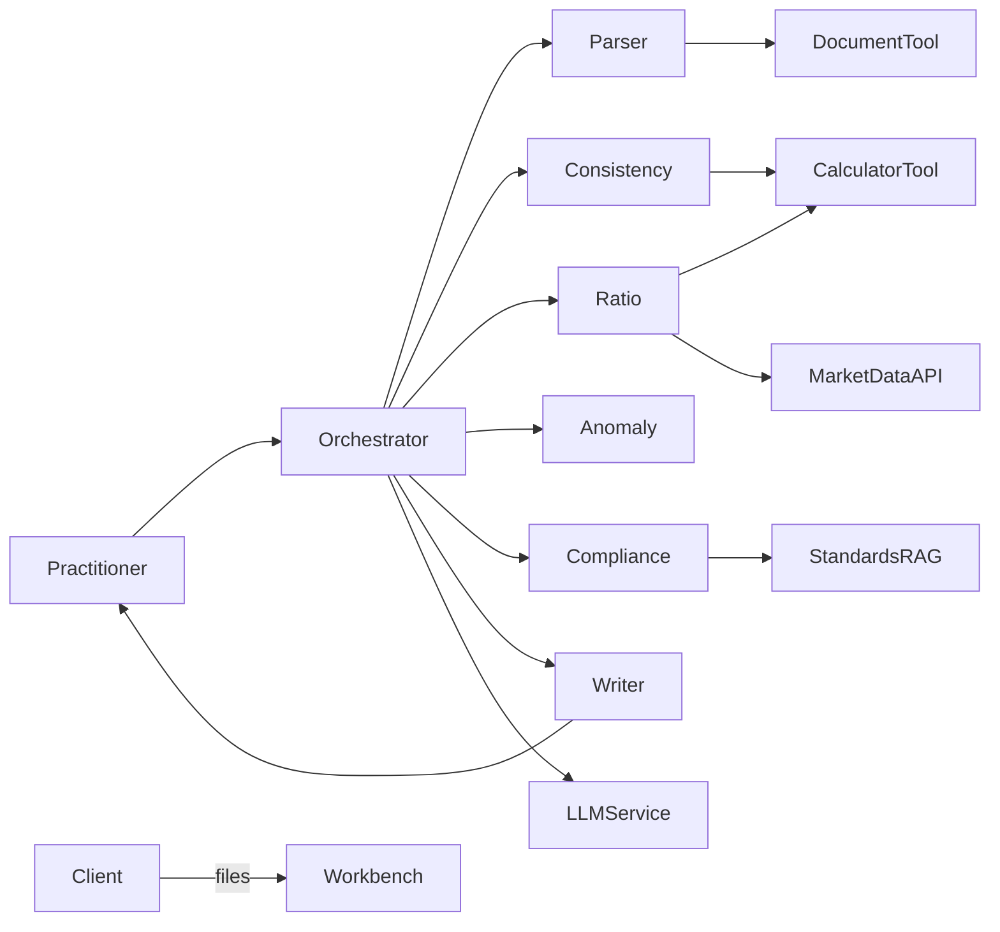
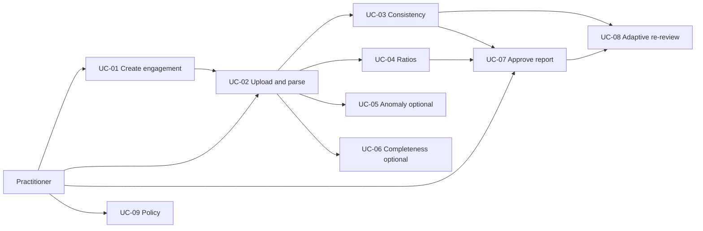
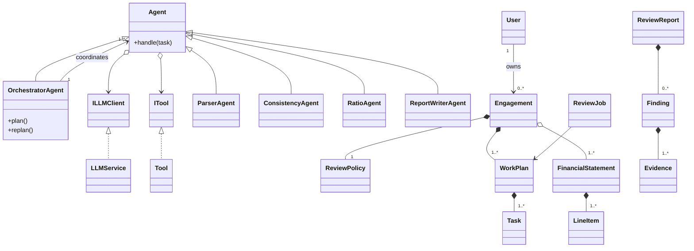
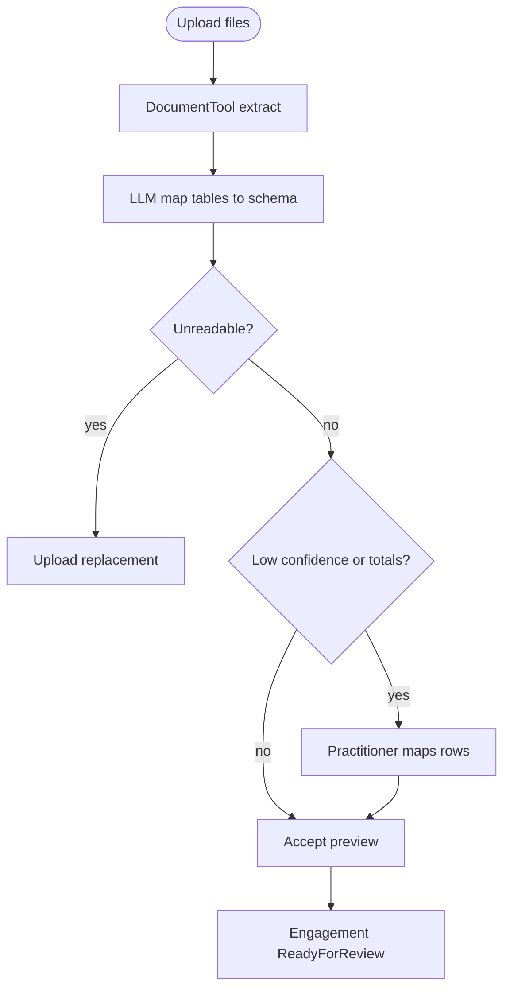
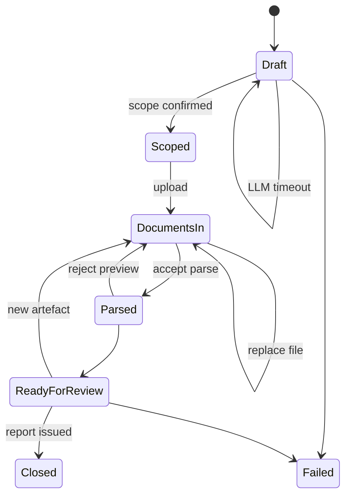
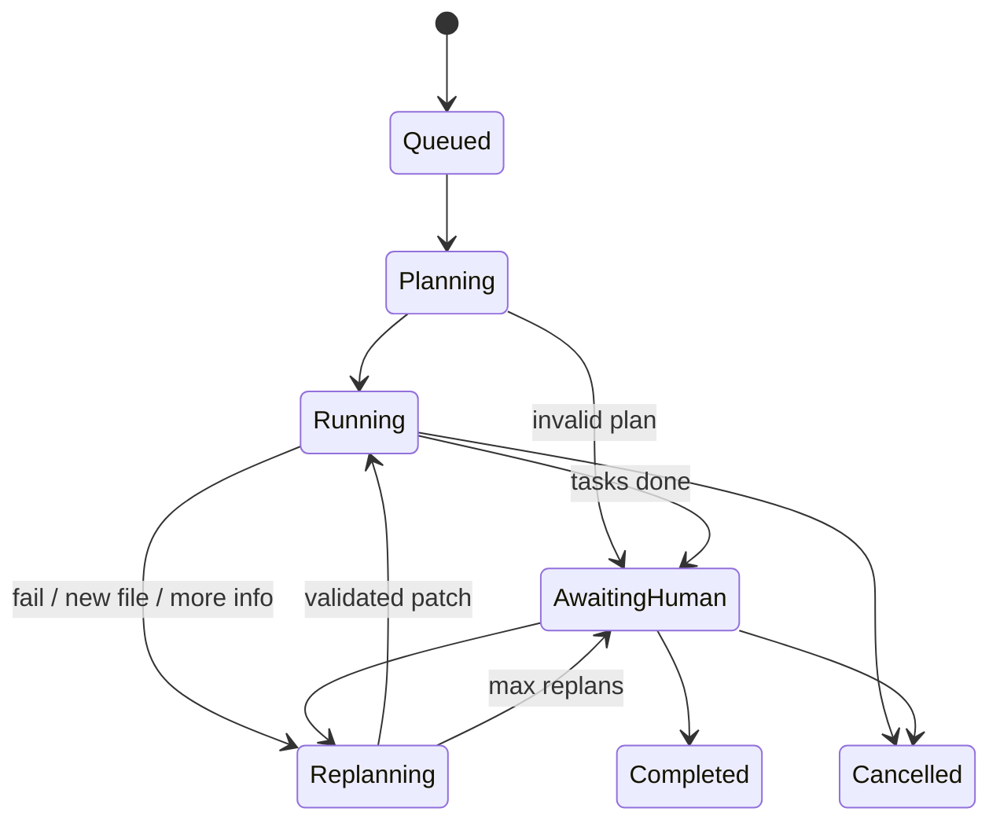
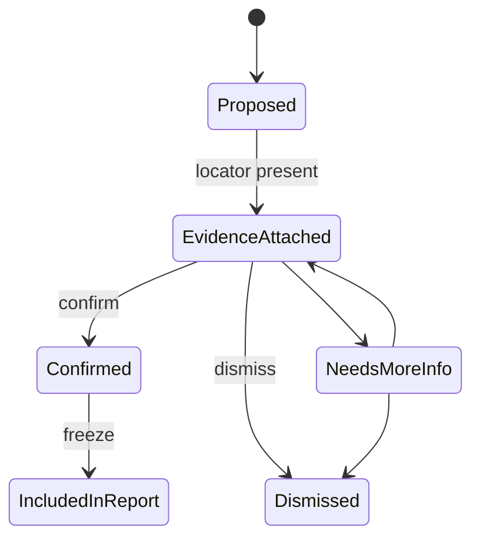

# ELEC5620 Stage 1 Report

# FinReview Co.: A One-Person Multi-Agent Firm for Analytical Review of Financial Statements

**Unit:** ELEC5620  
**Stage:** 1 — Requirements documentation, architecture design, and system modelling  
**Application area:** Finance  
**Theme:** One-Person AI Company  
**Group size:** 3 (Member A, Member B, Member C — replace with legal names before Canvas upload)

**Companion sources (same folder):**

| File | Content |
|---|---|
| [01-scope-and-requirements.md](01-scope-and-requirements.md) | Frozen scope, AGR/MAN/OPT, ad hoc requirements, assumptions |
| [02-use-case-specifications.md](02-use-case-specifications.md) | Full UC-01–UC-09 specifications |
| [03-architecture-and-traceability.md](03-architecture-and-traceability.md) | Viewpoints, LLM roles, traceability, contribution % |
| [video_script.md](video_script.md) | 8-minute presentation script |
| [interview_prep.md](interview_prep.md) | Interview pitches and drills |
| [diagrams/](diagrams/) | PlantUML sources for all models |

This report is the narrative that Project Description §1 requires. Diagrams are given in Mermaid for reading and in PlantUML for submission-quality export (`*.puml`).

---

## 1. Introduction and problem

Large language models can plan, call tools, and specialise. That makes a **one-person virtual firm** feasible: a human retains professional responsibility while agents occupy the roles of a small review team.

FinReview Co. is that firm in the **finance** application area. The practitioner (CPA or financial analyst) is the engagement partner. Clients supply financial statements. Agents perform intake, analytical procedures, optional assurance checks, and memorandum drafting. The human approves findings. The system **does not** issue a statutory audit opinion.

**Why this problem is the right size for ELEC5620**

- Multiple **business roles** (orchestrator, parser, analyst, writer) rather than a chatbot.
- **Tool use** (parsers, calculators) distinct from LLM prose — required to show perception vs decision vs interaction.
- **Adaptation based on results** (replan after a failed tick-and-tie or a dismissed finding).
- A clear **human-in-the-loop** life cycle, which yields state machines that are not decorative.

**In scope:** engagement scoping from a natural-language brief; upload and parse of Balance Sheet, Income Statement, Cash Flow Statement, notes (optional trial balance); cross-statement consistency; ratio analysis; evidence-backed review memo; selective replan.

**Out of scope:** bookkeeping from journals; tax lodgement; statutory audit opinions; live ERP monitoring.

An optional ad hoc overview of the software is [diagrams/ad-hoc-overview.puml](diagrams/ad-hoc-overview.puml).

---

## 2. Requirements classification

Project Description requires classification into **agreement**, **mandatory capabilities**, and **optional features**. Identifiers are stable and appear in the traceability matrix (Section 12).

### 2.1 Agreement (system contract)

| ID | Statement |
|---|---|
| AGR-01 | No statutory audit opinion. Outputs are *analytical review findings* pending sign-off. |
| AGR-02 | Every finding in a report is traceable to a line item, note, computed ratio, or disclosure locator. |
| AGR-03 | Client documents are not used to train foundation models (inference only). |

Changing an agreement is change-control, not a backlog tweak.

### 2.2 Mandatory capabilities

| ID | Capability |
|---|---|
| MAN-01 | Multi-role agents under an orchestrator |
| MAN-02 | Natural-language engagement scoping with materiality |
| MAN-03 | Statement upload and structured extraction |
| MAN-04 | Cross-statement consistency review |
| MAN-05 | Ratio and trend analysis |
| MAN-06 | Review-report generation with human approval |
| MAN-07 | LLM for perception, decision, and interaction |
| MAN-08 | Tool use (parsers, calculators; market data optional) |
| MAN-09 | Adaptive replanning after failed checks or dismissed findings |
| MAN-10 | Practitioner authentication and engagement ownership |

### 2.3 Optional features

OPT-01 anomaly detection; OPT-02 AASB/IFRS completeness RAG; OPT-03 industry benchmarks; OPT-04 multi-period comparison; OPT-05 export; OPT-06 local LLM; OPT-07 XBRL ingest; OPT-08 voice briefing.

Optional items appear on the feature diagram so Stage 2 can stub them without a domain rewrite.

### 2.4 Individual ad hoc requirements (*)

Each student contributed one informal requirement. Behaviour models are grown **only** from that requirement and its use cases (marking note 4).

**Member A — REQ-A-01.** As a sole practitioner opening a new client file, I want to describe the review in ordinary language (entity, period, emphasis, materiality) so the system drafts an engagement plan and tells me which statements to upload.

**Member B — REQ-B-01.** If a consistency check fails, or I dismiss a finding, I do not want the whole review restarted. The orchestrator should change only the affected steps, rerun them, and show me what changed.

**Member C — REQ-C-01.** Every red flag must carry evidence I can inspect (account, period, calculation or quote, source page). I must confirm, dismiss, or send it back before anything is treated as issued.

---

## 3. Feature diagram and non-functional requirements

One group feature diagram. Mandatory features use composition-like “filled” links; optional features use aggregation-like “empty” links; LLM provider is **xor**; input format is **or**.

PlantUML: [diagrams/feature-diagram-foda.puml](diagrams/feature-diagram-foda.puml), [diagrams/feature-diagram.puml](diagrams/feature-diagram.puml).

```mermaid
flowchart TB
  root[FinReview Co.]
  root --> Identity["F-Identity / confidentiality"]
  root --> Engagement["F-Engagement / interpretability"]
  root --> Intake["F-Intake / accuracy, latency"]
  root --> Orch["F-Orchestration / auditability"]
  root --> Adapt["F-Adapt / termination"]
  root --> HITL[F-HITL]
  root --> Cons["F-Consistency / numerical correctness"]
  root --> Ratios["F-Ratios / reproducibility"]
  root --> Report["F-Reporting / traceability, completeness"]
  root --> LLM[F-LLM]
  root --> Tools[F-Tools]
  root -.-> Anomaly[F-Anomaly OPT-01]
  root -.-> RAG["F-ComplianceRAG OPT-02 / citation integrity"]
  root -.-> Bench[F-Benchmark OPT-03]
  root -.-> Multi[F-MultiPeriod OPT-04]
  root -.-> Export[F-Export OPT-05]
  root -.-> Voice[F-Voice OPT-08]
  Intake --> Input["F-InputFormat OR"]
  Input --> PDF
  Input --> Excel
  Input --> XBRL
  LLM --> Prov["F-LLMProvider XOR"]
  Prov --> Cloud[Cloud LLM]
  Prov --> Local[Local LLM OPT-06]
```

NFRs are attached to features rather than listed in a vacuum: a change to reporting must still satisfy **traceability** and **completeness**; a change to replan must still **terminate**.

---

## 4. Actors, use-case overview, and specifications

**Overview diagram (group):** [diagrams/use-case-overview.puml](diagrams/use-case-overview.puml).

Actors: Practitioner (primary), Client (secondary, may only supply files), and external systems LLMService, DocumentTool, CalculatorTool, MarketDataAPI, StandardsStore.

Nine use cases (within the required 5–10). Full Cockburn-style specifications are in [02-use-case-specifications.md](02-use-case-specifications.md). Summary:

| UC | Name | Author | Ad hoc | Individual behaviour? |
|---|---|---|---|---|
| UC-01 | Create Review Engagement | A | REQ-A-01 | Sequence, Engagement SM |
| UC-02 | Upload and Parse Statements | A | REQ-A-01 | Activity |
| UC-03 | Cross-Statement Consistency Review | B | REQ-B-01 | Activity, Sequence |
| UC-04 | Ratio and Trend Analysis | B | REQ-B-01 | supports B sequence |
| UC-05 | Detect Anomalies (optional) | C | REQ-C-01 | feeds Finding |
| UC-06 | Check Disclosure Completeness (optional) | C | REQ-C-01 | feeds Finding |
| UC-07 | Generate and Approve Review Report | C | REQ-C-01 | Activity, Sequence, Finding SM |
| UC-08 | Adaptive Re-Review | B | REQ-B-01 | ReviewJob SM |
| UC-09 | Manage Review Policy | Group | — | — |

### 4.1 UC-01 Create Review Engagement (Member A) — excerpt

**Goal:** Open a scoped engagement with an initial work plan and a document checklist.  
**Main success:** Practitioner types a brief → OrchestratorAgent calls LLMService with a scoping schema → `Engagement` becomes `Scoped` → practitioner confirms materiality.  
**Extensions:** LLM timeout leaves `Draft`; missing entity/period triggers a clarifying question (LLM *interaction*).  
**Postcondition:** `ReviewPolicy.materiality` stored; `WorkPlan` lists mandatory tasks.

### 4.2 UC-02 Upload and Parse Statements (Member A) — excerpt

**Goal:** Persist `FinancialStatement` / `LineItem` graphs.  
**Main success:** DocumentTool extracts tables → LLM maps to a canonical schema → practitioner accepts preview → `ReadyForReview`.  
**Extensions:** Unreadable PDF; low-confidence rows requiring manual map; totals mismatch blocks UC-03.

### 4.3 UC-03 Consistency (Member B) — excerpt

**Goal:** Tick-and-tie without LLM arithmetic.  
**Main success:** CalculatorTool evaluates accounting equation, NI vs retained earnings movement, cash vs CFS; LLM explains **only** from numeric evidence; findings stored.  
**Extension:** Narrative that contradicts numbers is discarded.

### 4.4 UC-04 Ratios (Member B) — excerpt

Formula identifiers stored with `RatioResult`; commentary separate from values (reproducibility). Market API failure does not fabricate peers.

### 4.5 UC-05 / UC-06 (Member C, optional)

Same `Finding` type. UC-05 heuristics and UC-06 RAG citations must include locators or the finding cannot be Confirmed (AGR-02). If the feature flag is off, the work plan shows “not in scope”.

### 4.6 UC-07 Generate and Approve Review Report (Member C) — excerpt

**Goal:** Issue a memo containing only approved, evidence-backed findings.  
**Main success:** ReportWriterAgent drafts sections → practitioner Confirm / Dismiss / Needs more info → freeze snapshot.  
**Guard:** Confirm disabled without evidence. Wording edits regenerate prose only, not numbers. AGR-01 banner always present.

### 4.7 UC-08 Adaptive Re-Review (Member B) — excerpt

**Goal:** Rerun **only affected** tasks.  
**Main success:** LLM proposes a plan patch → orchestrator validates against a dependency graph (intake → analytical procedures → report) → stale outputs invalidated → diff shown.  
**Extensions:** Full-restart patch rejected; `maxReplans` exceeded → `AwaitingHuman` (termination NFR).

### 4.8 UC-09 Manage Review Policy (group)

Materiality, optional-agent flags, max replan. Changing flags may enqueue UC-08. Mandatory features cannot be turned off in the UI.

---

## 5. Architecture, viewpoints, and life-cycle processes

Optional architecture analysis is included because the unit emphasises model-based software engineering.

| Viewpoint | Models |
|---|---|
| Logical | Class diagram, `ILLMClient`, `ITool` |
| Process | Sequences, activities, collaboration, `ReviewJob` SM |
| Development | Package diagram |
| Physical | Deployment diagram |
| Life cycle | `Engagement` SM + the pipeline below |

**Life cycle of an engagement**

1. Brief and scope (UC-01, includes UC-09).  
2. Intake (UC-02).  
3. Analytical procedures (UC-03, UC-04, optional UC-05/06).  
4. Human gate (UC-07).  
5. Selective replan (UC-08) if needed.  
6. Issued memo or cancelled job.

High-level components and interdependencies: presentation (`ui`) talks only to `orchestration` and `domain`; specialists live in `agents` and depend on `tools` and `llm`; persistence is behind repositories. This is the package diagram ([diagrams/package-diagram.puml](diagrams/package-diagram.puml)).

**LLM in the life cycle (MAN-07)**

| Role | Life-cycle moment |
|---|---|
| Perception | Understanding the brief; mapping tables; matching notes to a checklist |
| Decision | Initial `WorkPlan`; UC-08 patch |
| Interaction | Clarifying questions; explanations; memorandum prose; wording edits |

Arithmetic and tick-and-tie are **not** LLM responsibilities (ASM-03).

---

## 6. Elementary structure modelling (class diagram)

PlantUML: [diagrams/class-diagram.puml](diagrams/class-diagram.puml). This model is worth 3 marks; associations are used deliberately.

**Generalisation:** `Agent` ← `OrchestratorAgent`, `ParserAgent`, `ConsistencyAgent`, `RatioAgent`, `AnomalyAgent`, `ComplianceAgent`, `ReportWriterAgent`; `Tool` ← `DocumentTool`, `CalculatorTool`, `MarketDataTool`.

**Interfaces:** `ILLMClient` realised by `LLMService`; `ITool` realised by `Tool`. Agents depend on interfaces, not on a vendor SDK.

**Composition (filled diamond):** `Engagement * ReviewPolicy`; `Engagement * WorkPlan`; `WorkPlan * Task`; `FinancialStatement * LineItem`; `Finding * Evidence`; `ReviewReport * Finding`.

**Aggregation (empty diamond):** `Engagement o FinancialStatement` (statements may be reused in comparatives later, OPT-04).

**Other associations:** `User` 1 — 0..* `Engagement`; `OrchestratorAgent` 1 → 1..* `Agent`; `Task` 0..* → 0..1 `Agent`; `Finding` cites `LineItem` / `RatioResult`.

**Multiplicity of note:** `Finding` to `Evidence` is **1..*** once attached; Confirm is only legal when evidence exists (AGR-02).

---

## 7. Complex structure modelling (runtime)

These models must **not** be a second copy of the class diagram. They show instances, ports, and collaboration roles.

### 7.1 Object diagram

[diagrams/object-diagram.puml](diagrams/object-diagram.puml) — snapshot of Harbor Retail Pty Ltd, FY2025: `job` in `AwaitingHuman` after one replan; `f1` Confirmed (cash articulation); `f2` Proposed (current ratio 0.72); three statement instances; orchestrator plus three specialist **instances**.

### 7.2 Structured class / composite structure

[diagrams/structured-class.puml](diagrams/structured-class.puml) — `OrchestratorAgent` ports:

| Port | Contract | Bound to |
|---|---|---|
| planOut | IWorkPlan | specialist agents |
| findingIn | IFinding | specialists producing findings |
| humanGate | IHumanApproval | Practitioner |
| llmPort | ILLMClient | LLMService |
| toolPort | ITool | DocumentTool, CalculatorTool |

A future `AnomalyAgent` binds to `planOut` and `findingIn` without changing `Engagement`.

### 7.3 Collaboration

[diagrams/collaboration.puml](diagrams/collaboration.puml) — roles Planner, Specialist, Calculator, Language model, Approver. Messages 1–9 cover assign → tool → grounded explanation → human gate → patched plan (UC-08).

---

## 8. Behaviour of key components

Each member’s three diagrams share **one story** with that member’s ad hoc requirement.

### 8.1 Member A — Intake (REQ-A-01)

**Activity (UC-02):** [diagrams/member-a-activity.puml](diagrams/member-a-activity.puml) — swimlanes Practitioner / ParserAgent / DocumentTool / LLMService; unreadable file and low-confidence rows.

**Sequence (UC-01 → start of UC-02):** [diagrams/member-a-sequence.puml](diagrams/member-a-sequence.puml) — scoping schema, timeout, clarifying question, then parse.

**State (`Engagement`):** [diagrams/member-a-state.puml](diagrams/member-a-state.puml)

**LLM role:** perception of brief and tables; decision of initial plan; interaction for missing slots.

### 8.2 Member B — Analysis (REQ-B-01)

**Activity (UC-03):** [diagrams/member-b-activity.puml](diagrams/member-b-activity.puml) — CalculatorTool rules; LLM explanation; contradiction dropped; material fail → UC-08.

**Sequence (UC-03 + UC-04):** [diagrams/member-b-sequence.puml](diagrams/member-b-sequence.puml) — parallel specialists; optional market API; decision patch.

**State (`ReviewJob`):** [diagrams/member-b-state.puml](diagrams/member-b-state.puml)

**LLM role:** interaction (explanations, commentary); decision (replan patch). Orchestrator **enforces** the graph so REQ-B-01 cannot be violated by a sloppy LLM.

### 8.3 Member C — Assurance (REQ-C-01)

**Activity (UC-07):** [diagrams/member-c-activity.puml](diagrams/member-c-activity.puml) — draft, HITL loop, AGR-02 gate, wording-only regenerate, freeze.

**Sequence (UC-05/06 optional + UC-07):** [diagrams/member-c-sequence.puml](diagrams/member-c-sequence.puml).

**State (`Finding`):** [diagrams/member-c-state.puml](diagrams/member-c-state.puml)

**LLM role:** interaction only (narrative and memo prose). It **cannot** fire Confirm.

---

## 9. Support components

Principal agents are described above. Support components:

| Component | Responsibility | Dependence |
|---|---|---|
| DocumentTool | PDF/Excel/XBRL → tables | ParserAgent |
| CalculatorTool | Ratios and tick/tie | ConsistencyAgent, RatioAgent, AnomalyAgent |
| LLMService | Schema-constrained completion | All agents via `ILLMClient` |
| Object store | Immutable source blobs | Intake |
| Repositories | Persist domain graph | API host |
| MarketDataAPI | Optional peer bands | RatioAgent |
| StandardsStore | Optional RAG chunks | ComplianceAgent |

Failures: parse errors keep `DocumentsIn`; calculator errors fail the task closed; LLM outage queues the job (ASM-05); empty standards store fails UC-06 closed (no invented citations).

---

## 10. Relationships that support future development

- **New specialist:** subclass `Agent`, bind `planOut` / `findingIn`. Domain types stay.
- **New tool:** implement `ITool`; no change to `Finding`.
- **New LLM vendor or local model:** implement `ILLMClient` (`F-LLMProvider` xor).
- **Optional flags:** `ReviewPolicy` booleans; UC skipped when false.
- **Comparatives (OPT-04):** additional `FinancialStatement` instances on the same aggregation; ratio formulae already take named inputs.

This is why D1 (mega-agent) and D3 (pipeline-only) were rejected: neither gives a stable extension seam.

---

## 11. Assumptions and discarded alternatives

Assumptions ASM-01–ASM-08 are listed in [01-scope-and-requirements.md](01-scope-and-requirements.md) (single practitioner in the prototype; imperfect PDFs; tools own arithmetic; materiality is supplied not legally inferred; LLM available; IFRS/AASB orientation; one entity/period; Stage 2 stack is planned not built).

| ID | Discarded | Chosen | Rationale |
|---|---|---|---|
| D1 | One mega-agent on the whole report | Orchestrator + specialists | Examinable roles; isolatable failure; matches a firm |
| D2 | Fully automatic pass/fail | Human-in-the-loop | AGR-01; Finding state machine; professional duty |
| D3 | Sequential pipeline or blackboard | Orchestrator + graph-cut replan | Pipeline breaks REQ-B-01; blackboard is over-weight |

Secondary: fine-tune on AASB text rejected in favour of optional RAG (data rights, cost). XBRL-only intake rejected; LLM perception of PDF/Excel is mandatory with XBRL optional.

---

## 12. Change assessment and acceptance determination

**IDs are the unit of change.** Impact is read off the feature diagram (which siblings share `Finding`, `WorkPlan`, …) and off the matrix in [03-architecture-and-traceability.md](03-architecture-and-traceability.md).

| Change class | Example | Acceptance |
|---|---|---|
| Agreement | Drop HITL | Group re-approval; rewrite UC-07 and Member C SM — likely rejected |
| Mandatory feature | Add a new ratio pack | New `formulaId`s; UC-04 postcondition still holds |
| Optional toggle | Enable OPT-01 | UC-05 postcondition; same `Finding` type |
| NFR tightening | Lower parse latency | Stage 2 measurement; intake feature unchanged |

**Acceptance oracle for Stage 2:** use-case postconditions (e.g. issued report contains only `Confirmed` findings with evidence). Individual `*` models remain valid only if they still trace to the author’s ad hoc requirement.

**Ten-second rule:** any activity node must map to one REQ and one UC immediately, or the diagram is redrawn.

Excerpt of the matrix:

| Requirement | UCs | Owner | Behaviour artefacts |
|---|---|---|---|
| REQ-A-01 | UC-01, UC-02 | A | member-a-* |
| REQ-B-01 | UC-03, UC-04, UC-08 | B | member-b-* |
| REQ-C-01 | UC-05, UC-06, UC-07 | C | member-c-* |
| AGR-02 | UC-07 | C / Group | Finding SM guard |
| MAN-09 | UC-08 | B | ReviewJob `Replanning` |

---

## 13. Contribution of each group member

Individual tasks (`*`) are 100% the named author. Group-task percentages:

| Artefact | A | B | C |
|---|---|---|---|
| REQ / UC specs / activity / SD / SM | REQ-A-01; UC-01,02; A diagrams | REQ-B-01; UC-03,04,08; B diagrams | REQ-C-01; UC-05,06,07; C diagrams |
| Feature diagram | 35% | 35% | 30% |
| Use case overview | 34% | 33% | 33% |
| Class diagram | 30% | 35% | 35% |
| Object diagram | 30% | 40% | 30% |
| Structured class | 20% | 50% | 30% |
| Collaboration | 20% | 40% | 40% |
| Package / deployment | 30% | 40% | 30% |
| Report chapters | Intro, intake | Architecture, analysis | HITL, change control |
| Video / interview | Intake story | Replan story | Evidence story |

Replace Member A/B/C with student names and SIDs before submission. All three members participated in every group diagram (marking note 3).

---

## 14. Appendix — diagram source index

| Model | Marks | File |
|---|---|---|
| Ad hoc overall design | Optional | [diagrams/ad-hoc-overview.puml](diagrams/ad-hoc-overview.puml) |
| Feature diagram | 1 | [diagrams/feature-diagram-foda.puml](diagrams/feature-diagram-foda.puml) |
| Use case overview | 1 | [diagrams/use-case-overview.puml](diagrams/use-case-overview.puml) |
| Class diagram | 3 | [diagrams/class-diagram.puml](diagrams/class-diagram.puml) |
| Object diagram | 3 (complex) | [diagrams/object-diagram.puml](diagrams/object-diagram.puml) |
| Structured class | 3 (complex) | [diagrams/structured-class.puml](diagrams/structured-class.puml) |
| Collaboration | 3 (complex) | [diagrams/collaboration.puml](diagrams/collaboration.puml) |
| Package | Optional | [diagrams/package-diagram.puml](diagrams/package-diagram.puml) |
| Deployment | Optional | [diagrams/deployment-diagram.puml](diagrams/deployment-diagram.puml) |
| A activity / SD / SM | 1.5 each * | `member-a-*.puml` |
| B activity / SD / SM | 1.5 each * | `member-b-*.puml` |
| C activity / SD / SM | 1.5 each * | `member-c-*.puml` |

Export: install [PlantUML](https://plantuml.com/) and run `plantuml docs/stage1/diagrams/*.puml`, or paste into the PlantUML web server. Insert PNGs into the Word/PDF Canvas upload.

**Stage 2 (not implemented here):** LangGraph or CrewAI, FastAPI, React workbench, PDF/Excel parsers, LLM API. Demonstration must show LLM perception, decision, and interaction on the mandatory path.

---

*End of Stage 1 report.*
